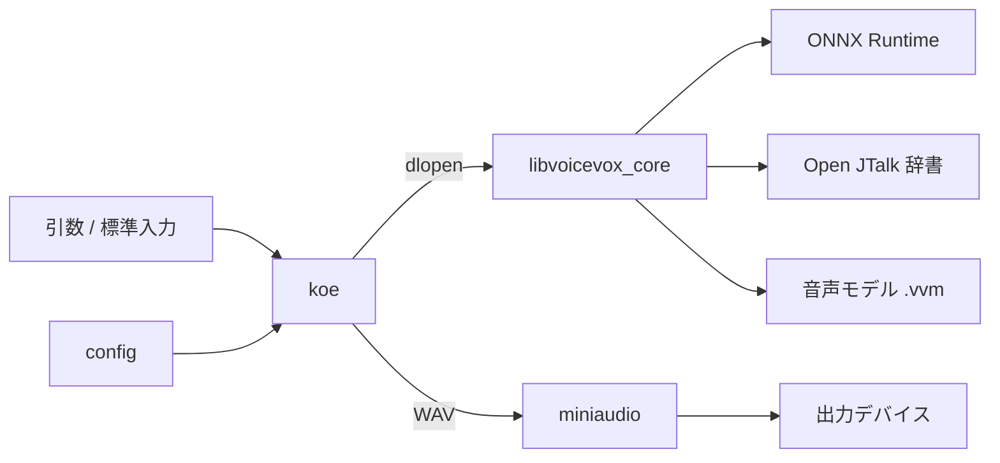

# koe 設計

- Status: Draft
- Updated: 2026-09-16

## 1. 何を作るか

`koe` は、AI エージェントが人間へ声で合図するための CLI である。

- 引数か標準入力の日本語テキストを、VOICEVOX CORE でその場で合成する。
- 合成した WAV を miniaudio で in-process 再生し、喋り終わるまで返らない。
- Linux / Windows / macOS で同じ名前、同じ引数、同じ設定ファイルで動く。

### 動機

エージェントに「N 秒後に○○して、その M 秒後に□□して」と手順を出されても、
画面を読みながらではタイミングが合わない。声で言われると合う。
`ask` で質問を立てたとき、席にいれば声で気づいてターミナルで即答できる。
いずれも「喋る」だけの独立した部品があれば足りる。

### なぜ名前が `koe` か

`say` は macOS 標準コマンドと衝突し、`speak` は espeak 系が同名で置く。
将来 Mac が加わったときに使い方が変わらないよう、どの OS の既存コマンドとも
パッケージレジストリ（PyPI / crates.io / npm / Arch）とも被らない名前にした。

### なぜ VOICEVOX CORE か

前提は「オフライン」「無料」「ライセンスがゆるい」「ネイティブ CLI」。

| 候補 | 落とした理由 |
| --- | --- |
| Edge TTS（edge-tts 系） | Edge ブラウザの読み上げ用エンドポイントを非公式に叩く裏道 |
| Azure / Polly / OpenAI | 公式だがアカウントとキー管理が増え、ネット必須 |
| OS 標準音声 | Linux に相当品がなく、三 OS で挙動が揃わない |
| Open JTalk 単体 | 保守が止まっている |
| sherpa-onnx + Kokoro | 日本語の読みの品質が未確認 |

VOICEVOX CORE は MIT、活発に保守され、日本語の品質が候補中で最良。
C API を公式配布しており、C から直接呼べる。起動は 1 秒弱で合図用途に足りる。

### なぜ C + miniaudio か

VOICEVOX CORE が C API なので、C で書けば FFI 層が消える。
miniaudio は単一ヘッダ（MIT-0 / パブリックドメイン）で、PulseAudio / ALSA /
WASAPI / CoreAudio を一つの API で扱い、デバイス列挙と選択が三 OS で同じコードになる。
WAV デコードも内蔵。結果として子プロセスも外部の再生ツールも要らない。

Go で書く案は `go build` 一つで済む利点があったが、purego で C API を一関数ずつ
束ねる手間と、Windows で出力デバイスを選べない欠点があった。

## 2. 前提と割り切り

- 日本語テキストのみ。読みは VOICEVOX CORE と Open JTalk 辞書に任せる。
- 一回の実行で一文。長文の分割や SSML は扱わない。
- VOICEVOX CORE の配置は公式 Downloader に任せ、`koe` は置き場所を設定で知るだけ。
- CPU 版のみ。GPU（CUDA / DirectML）は扱わない。
- 設定は `key=value` 行の自前パースで、TOML ライブラリは足さない。
- 常駐しない。毎回ライブラリと辞書とモデルを読み込む。起動 1 秒弱は許容する。
- 音声のファイル出力、話速・音高の調整、複数話者の切り替えは MVP ではやらない。

## 3. 構成

ファイル構成:

| ファイル | 役割 |
| --- | --- |
| `koe.c` | 引数と設定の解釈、VOICEVOX CORE の呼び出し、再生 |
| `config.c` / `config.h` | `key=value` ファイルの読み込み。テスト対象 |
| `miniaudio.h` | 同梱。再生とデバイス列挙 |
| `voicevox_core.h` | 同梱。VOICEVOX CORE の C API 宣言 |
| `Makefile` | `cc` でのビルドとテスト（Linux / macOS） |
| `koe.manifest` | Windows 用。`argv` と A 系 API を UTF-8 にする |
| `.github/workflows/build.yml` | 三 OS でのビルドとテスト。タグ push で release に実行ファイルを添付 |

## 4. 処理の流れ

1. 引数を解釈する。サブコマンド `devices` / `styles` はそれぞれ一覧を出して終わる。
   引数がなければ標準入力を末尾まで読む。空なら終了コード 2。
2. 設定ファイルを読む。無ければ既定値。`core` の既定は
   `~/.local/share/koe/voicevox_core`（Windows は `%LOCALAPPDATA%\koe\voicevox_core`）。
3. `{core}/c_api/lib` から `libvoicevox_core` を `dlopen` / `LoadLibrary` し、
   使う関数だけシンボル解決する。
4. VOICEVOX CORE を初期化する。順序は公式サンプルに倣う。
   - `voicevox_onnxruntime_load_once`。ファイルは `{core}/onnxruntime/lib` を
     版なしの推奨名（`libvoicevox_onnxruntime.so` 等）を接頭辞にして探す。
     core が返す版付きの推奨名は Downloader が置いた版と一致しないことがあるため。
   - `voicevox_open_jtalk_rc_new`（`{core}/dict` 配下の `open_jtalk_dic*`）
   - `voicevox_synthesizer_new`。`cpu_num_threads` は 4 に固定する。0（自動）だと
     ONNX Runtime が CPU affinity を設定しようとし、cgroup 等で CPU が絞られた
     環境では失敗ログを大量に出して遅くなる。合成時間は 2〜4 スレッドで頭打ちだった。
   - `{core}/models/vvms/*.vvm` を `voicevox_voice_model_file_open` して
     `voicevox_synthesizer_load_voice_model`
5. `voicevox_synthesizer_tts(text, style)` で WAV を得る。
6. miniaudio で WAV をデコードし、`ma_device_id` が設定の `device` と完全一致する
   出力デバイスで再生する。空なら OS 既定。
   再生完了まで待ち、`voicevox_wav_free` して終了コード 0。
7. どこかで失敗したら `voicevox_error_result_to_message` か miniaudio の
   結果コードを標準エラーに出し、終了コード 1。

core のログは tracing の `RUST_LOG` で制御される。未設定だと INFO が標準エラーに
出るので、koe は `RUST_LOG` が未設定のときだけ `error` を設定してから core を読む。

## 5. 文字コード

`koe` はテキストを解釈せず UTF-8 のバイト列として通す。
`voicevox_synthesizer_tts` の入力は UTF-8 と明記されている。

- Linux / macOS: `argv`、標準入力、設定ファイルはそのまま UTF-8。
- Windows: 実行ファイルに `koe.manifest`（`activeCodePage=UTF-8`、Windows 10 1903 以降）を
  埋め込む。これで `argv` も `fopen` / `LoadLibraryA` などの A 系 API も UTF-8 になり、
  C 側は三 OS とも同じ `main` 一つで済む。埋め込みは CI の `mt.exe` 一工程。
  残る変換は miniaudio が `wchar_t` で返す WASAPI のデバイス ID だけで、
  `setlocale(LC_ALL, ".UTF-8")` の上で C 標準の `wcstombs` を使う。
- 標準入力はどの OS でもバイト列をそのまま UTF-8 とみなす。

## 6. 設定

`~/.config/koe/config`（Windows は `%APPDATA%\koe\config`）。
`#` 始まりと空行は無視。`key=value` 一行一項目。

| key | 既定 | 意味 |
| --- | --- | --- |
| `core` | `~/.local/share/koe/voicevox_core` | Downloader の `-o` に渡した配置先 |
| `style` | `3` | スタイル ID。`koe styles` で一覧 |
| `device` | 空 | 出力デバイスの ID（後述）。空なら OS 既定 |
| `volume` | `1.0` | 音量倍率。miniaudio 側で掛ける |

### 出力デバイスの ID

`device` は koe 独自の番号ではなく、バックエンドが持つ識別子をそのまま受ける。
miniaudio は各バックエンドの識別子を `ma_device_id` として露出しており、
完全一致で選ぶ。友好名（`Ryzen HD Audio Controller Analog Stereo` など）は
同名の曖昧さと OS 更新で変わる問題があるので受けない。

| バックエンド | ID の中身 | OS 側で見る方法 |
| --- | --- | --- |
| PulseAudio（PipeWire の pulse 互換含む） | sink 名。例: `alsa_output.pci-0000_04_00.6.analog-stereo` | `pactl list short sinks` |
| ALSA | デバイス名 | `aplay -L` |
| WASAPI | endpoint ID 文字列 | 手軽な OS 標準 CLI がない |
| CoreAudio | device UID | 手軽な OS 標準 CLI がない |

miniaudio は Linux で PulseAudio を ALSA より先に試すため、通常は `pactl` の
sink 名がそのまま使える。`koe devices` は Windows / macOS で ID を見る手段が
乏しいための一覧表示で、`ID<TAB>名前` を一行ずつ出し、OS 既定に印を付ける。

出力デバイスと音量を設定に置くのは、既定デバイスの音量が 0 で聞こえなかった
経験から。機ごとに違う値なので設定ファイルは機ごとに持ち、リポジトリに入れない。

### ビルドと配布

ビルドは GitHub Actions に寄せる。Linux / macOS は `make test && make`、Windows は
MSVC の `cl` で同じソースをビルドし、`mt.exe` でマニフェストを埋める。
`v*` タグを push すると release が作られ、`koe-linux-x64` / `koe-macos-arm64` /
`koe-windows-x64.exe` が添付される。各機の導入は Releases から取るだけで、
C ツールチェインは要らない。CI で確かめられるのはビルドとテストまでで、
音が出るかは各機で一度聞く。

## 7. テスト

- `config.c` の単体テスト（既定値、コメントと空行、未知キーの無視、空白の扱い、
  不正値の拒否）を `make test` で回す。
- 合成と再生は音を聞くしかないので、受入条件で人間が確認する。
- `koe devices` と `koe styles` は実機で出力を目視する。

## 8. 受入条件

1. README の手順どおりに Linux 機へ配置・ビルド・設定し、`koe "テスト"` が
   本体スピーカーから聞こえる。（確認済み）
2. `koe devices` に本体スピーカーが出て、`device=` に指定するとそこから鳴る。
   存在しない ID は終了コード 1 で拒む。（確認済み。既定と別デバイスからの再生は
   HDMI 側にスピーカーがなく未確認）
3. `echo テスト | koe` でも同じ結果になる。（確認済み）
4. Windows 機でのビルドと再生は README に「未検証」と明記し、確認できた時点で更新する。

## 9. この案を卒業する条件

- 起動 1 秒弱が合図用途で気になる（常駐化か、モデルの事前読み込みを検討する）。
- 話者や話速を変えたくなる（設定項目の追加で済む範囲）。
- Windows の CI ビルドが保守しきれなくなる（Go + purego 案に戻る）。

## 10. 参考資料

- [VOICEVOX CORE](https://github.com/VOICEVOX/voicevox_core) — MIT
- [VOICEVOX CORE Downloader](https://github.com/VOICEVOX/voicevox_core/blob/main/docs/guide/user/downloader.md)
- [C API ヘッダ](https://github.com/VOICEVOX/voicevox_core/blob/main/crates/voicevox_core_c_api/include/voicevox_core.h)
- [C++ サンプル（初期化から合成までの順序）](https://github.com/VOICEVOX/voicevox_core/blob/main/example/cpp/unix/talk.cpp)
- [音声モデルとスタイル ID の対応表](https://github.com/VOICEVOX/voicevox_vvm/blob/main/README.md)
- [音声モデル利用規約](https://github.com/VOICEVOX/voicevox_vvm/blob/main/TERMS.txt)
- [miniaudio](https://github.com/mackron/miniaudio) — MIT-0 / パブリックドメイン
